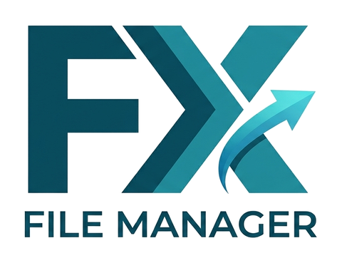
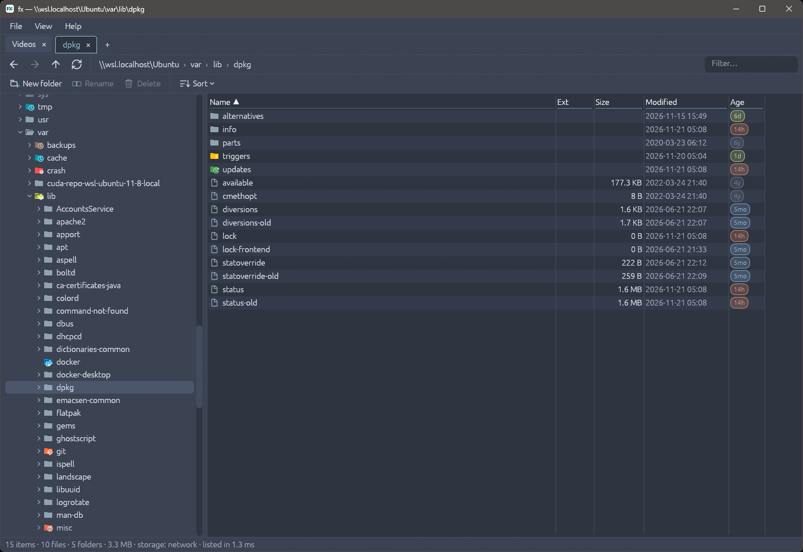

# fx File Manager

A performance optimized cross platform file manager written in Rust.
It searches file names recursively with results that stream in while the walk runs, and needs no index.

## Documentation

- [Features, with screenshots](docs/features.md)
- [Layout](docs/layout.md)
- [Settings](docs/settings.md)
- [Themes](docs/themes.md)
- [Translating](docs/translating.md)
- [Console app](docs/console.md)
- [Copy engine](docs/copy-engine.md)
- [Performance](docs/performance.md)
- [Development, builds and releases](docs/development.md)

## Contributing

Commit messages and pull request titles follow [Conventional Commits](https://www.conventionalcommits.org/en/v1.0.0/).
`fix` bumps the patch version, `feat` the minor version, and `!` or `BREAKING CHANGE` a breaking release.

## License

GPL-3.0-only. See [LICENSE](LICENSE).
Copyright (c) 2026 Florian Krämer.
